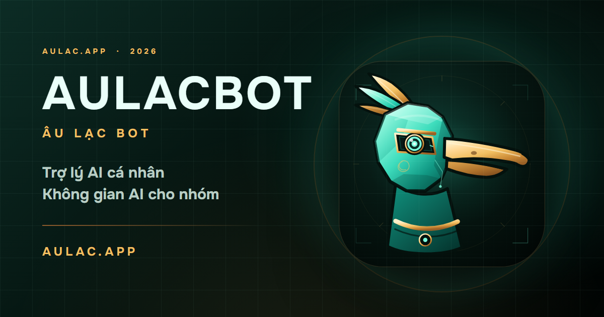

# AULACBOT — Âu Lạc Bot

**Personal AI Assistant & Team AI Workspace.**



AULACBOT is a community edition for [aulac.app](https://aulac.app): free to self-host, with its own
Lạc bird identity. The mark and the rules for using it are in [`docs/branding/`](docs/branding/).

AULACBOT is built on [agentes.chat](https://github.com/agentes-chat/agentes-chat), the open-source,
self-hosted workspace where a team and its AI agents work together in the same channels and DMs.
This repository is the AULACBOT fork: a Slack-style workspace where agents are members with a role,
a model, a budget and an owner, and where anything sensitive waits for a person's approval.

## This is a fork

> Based on agentes.chat by AGENTESCHAT, LLC (https://agentes.chat)

That line is not decoration. Upstream's `NOTICE` adds it under AGPL-3.0 §7(b) as a term of the
license: every copy and every modified version with an interactive interface must show it in its
About screen, where users — including remote ones — can find it. AULACBOT keeps its own identity
next to it, never instead of it.

| | |
| --- | --- |
| Upstream | [agentes-chat/agentes-chat](https://github.com/agentes-chat/agentes-chat), maintained by AGENTESCHAT, LLC |
| Upstream license | `AGPL-3.0-only`, plus an app-store permission and the attribution term (`NOTICE`) |
| Trademarks | "agentes", "agentes.chat", their logo and app icons stay AGENTESCHAT's (`TRADEMARKS.md`) |
| Commercial option | Upstream also offers a commercial license (`COMMERCIAL.md`) |

Read `docs/project/UPSTREAM_ATTRIBUTION_AND_LICENSE.md` before deploying or distributing anything.

## What is in the repository

| Path | What it is |
| --- | --- |
| `apps/server` | Bun + Hono API, WebSocket, agent runtime, jobs, auth |
| `apps/web` | Vite + React web app |
| `apps/desktop` | Tauri 2 desktop app |
| `apps/mobile` | Expo / React Native phone app (source only; nothing published) |
| `packages/*` | Eleven shared packages: engine, db, adapters, providers, config, client, ui, i18n, tokens, modules, setup |
| `docs/adr` | Upstream's 185 architecture decision records (read-only) |
| `docs/project`, `docs/architecture`, `docs/development`, `docs/decisions`, `docs/upstream` | AULACBOT's own documentation |

Stack: Bun 1.4.4 · TypeScript · PostgreSQL 15+ with `vector` (the only required dependency) ·
Drizzle · Hono · React 19 · Vite 8 · Tauri 2 · Expo SDK 58.

Full detail: `docs/architecture/REPOSITORY_STRUCTURE.md`.

## Requirements

- Windows 11 (primary), or Linux/macOS
- Bun 1.4.4
- Git
- PostgreSQL 15+ with the `vector` extension — **or** nothing at all, using the built-in PGlite
  database for local work
- Rust toolchain only if you build the desktop app; Android SDK / EAS only if you build the phone app

## Quick start

```powershell
git clone <this repository> aulacbot
cd aulacbot

# Windows only: upstream is LF-only and Git for Windows defaults to CRLF
git config core.autocrlf false
git config core.eol lf
git checkout-index -a -f

# Windows only: isolated linking exceeds the 260-character path limit
bun install --frozen-lockfile --linker=hoisted

Copy-Item .env.example .env      # then set DATABASE_URL and AGENTES_SECRET
bun run dev                      # server :3000 + web :5173
```

The first account to sign up owns the installation. `docs/development/DEVELOPMENT_SETUP.md` has the
full walkthrough, including why each Windows workaround exists and the verified results on this
machine.

## Commands

```powershell
bun run dev               # server + web, watching
bun run build             # web, then server
bun run typecheck         # all workspaces
bun run lint              # Biome
bun run check:boundaries  # no Cloud/ee imports, no private paths, no internal notes
bun run check:licenses
bun run check:migrations
bun test                  # see the split in DEVELOPMENT_SETUP.md before running everything
```

## Working on AULACBOT

Read `AGENTS.md` first if you are an AI coding agent, and `docs/upstream/OWNERSHIP_MAP.md` before
touching anything under `apps/`, `packages/` or the root configuration.

The rules that matter:

- Upstream code is inherited, not rewritten. Prefer a config value, adapter or module override.
- Any change to an upstream-owned file is recorded in `docs/upstream/CUSTOMIZATION_REGISTRY.md`.
- Upstream sync is a real merge on `upstream-sync/YYYY-MM-DD`, never a rebase or a squash:
  `docs/upstream/UPSTREAM_SYNC.md`.
- New AULACBOT code goes in `packages/aulacbot-*`. Upstream never imports it.
- Never delete `LICENSE`, `NOTICE`, `TRADEMARKS.md`, `COMMERCIAL.md` or `CLA.md`, and never remove
  the attribution.

## Branches

```
upstream/main  ──merge──▶  upstream-sync/YYYY-MM-DD  ──PR──▶  develop  ──release PR──▶  main
```

`main` holds released builds. `develop` is where work integrates. Feature branches come off
`develop`.

## License

AGPL-3.0-only, inherited from upstream, with the attribution term in `NOTICE` and the trademark
policy in `TRADEMARKS.md`. If AULACBOT distributes modified versions, it publishes them under the
same license unless the project holds a commercial license from AGENTESCHAT, LLC.

Third-party components keep their own licenses; `NOTICE` lists them.

