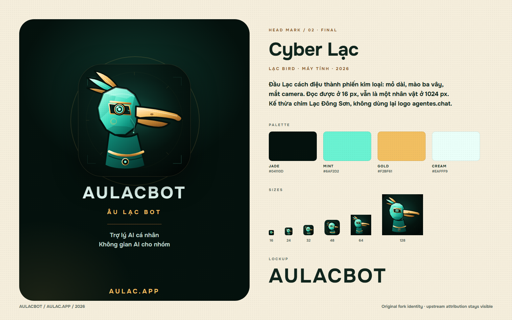

# AULACBOT brand

**AULACBOT** · **Âu Lạc Bot** · Personal AI Assistant & Team AI Workspace · [aulac.app](https://aulac.app)

The identity is **Cyber Lạc**: the Lạc bird of the Đông Sơn drums drawn as a machine head, front on
and with no neck, in jade, mint and gold. Everything lives in [`cyber-lac/`](cyber-lac/README.md):
the vector masters, the rendered sizes, the palette and type rules, and the map of every place it is
wired into the app.

## Where things are

| Path | What it is |
| --- | --- |
| [`cyber-lac/README.md`](cyber-lac/README.md) | The mark, the palette, the type rules, the asset table, how to regenerate |
| [`cyber-lac/REPLACEMENT-MAP.md`](cyber-lac/REPLACEMENT-MAP.md) | Every file the identity touches, what is done, what is deliberately left upstream |
| `cyber-lac/assets/` | Rendered PNG/SVG/ICO: store, web root, iOS, Android, email, desktop, tray |
| `cyber-lac/source/` | The vectors the renderer reads |
| `cyber-lac/generate.mjs` | Rasterises `source/` with a headless Chromium |
| [`legacy/`](legacy/README.md) | The earlier "Lạc bird as A" kit, kept for history only — do not use |

## The short version

- **Wordmark:** `AULACBOT`, all caps, Onest 700, `+0.05em` tracking; `.app` follows in Doto where the
  lockup shows a domain. Use `Âu Lạc Bot` only in prose.
- **Mark:** the head in a jade tile at 64 px and above; the 32-unit glyph below that. Never below
  16 px, never stretched, never recoloured into upstream's blue.
- **Colours:** Jade `#04110D`, Mint `#6AF2D2`, Gold `#F2BF61`; Cream `#EAFFF9` and Bronze `#8F5C2C`
  as support.
- **In the app:** the icons ship from `packages/ui/scripts/app-icons/cyber-lac.mjs`; the logo in the
  windows is the flat SVG head in `packages/ui/src/components/Logo.tsx`. Upstream attribution stays
  visible in About (`Based on agentes.chat by Codari Global, LLC`).
