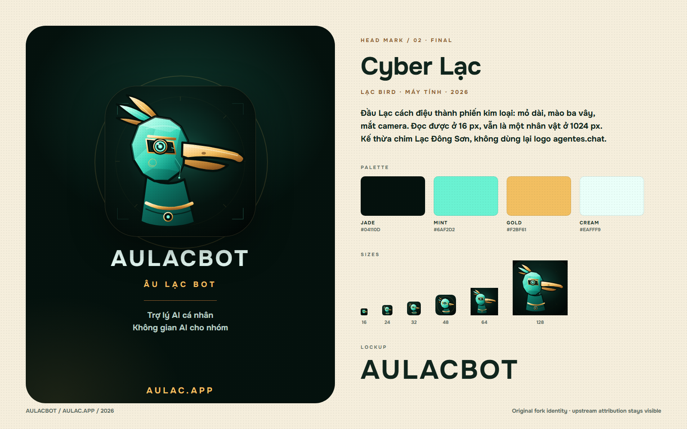

# Cyber Lạc — AULACBOT identity

**AULACBOT** · **Âu Lạc Bot** · Personal AI Assistant & Team AI Workspace · [aulac.app](https://aulac.app)

This is the identity the owner chose on 2026-11-17: **02 Cyber Lạc**, the finalist on
`outputs/brand-v4/board.png`. It replaces the earlier "Lạc bird as A" kit in `docs/branding/assets/`.
Nothing in this folder comes from agentes.chat's blue square or its agent mark.



## The mark

The Lạc bird of the Đông Sơn bronze drums, redrawn as a **machine mask**:

- a faceted mint head, so it reads as cast metal rather than a mascot;
- a long gold bill and a three-fin crest, the bird's two signatures;
- a camera visor with a mint lens: the assistant that watches the work;
- a neck drum with a gold collar, the drum's sun and the workspace's channel;
- a dark jade tile with a measuring ring and corner brackets, the "instrument" frame.

The detailed mark is for 64 px and above. Below that, use the **glyph**: the head, bill, visor and
crest with the neck simplified. It is drawn on a 32-unit grid so 16 and 32 px stay legible.

## Palette

| Name | Hex | Use |
| --- | --- | --- |
| Jade | `#04110D` | Primary tile, ink on light, dark surfaces |
| Deep Jade | `#0C2C25` | Tile gradient, secondary surface |
| Mint | `#6AF2D2` | Head, lens, the live signal |
| Gold | `#F2BF61` | Bill, crest, rules, labels |
| Cream | `#EAFFF9` | Wordmark on Jade, highlights |
| Bronze | `#8F5C2C` | Secondary rules and small type on paper |

Jade, Mint and Gold carry the identity; the mark still reads in one colour through the mono glyph.

## Type

Onest (already in `packages/engine/assets/fonts`, OFL) in **Bold 700** for `AULACBOT`, with
`+0.055em` tracking. Use `Âu Lạc Bot` as the display name, `AULACBOT` as the wordmark and
`aulac.app` as the domain. Do not set the wordmark in upstream's Funnel Display + Doto lockup.

## Assets

| File | Use |
| --- | --- |
| `assets/cyber-lac-mark.svg` | The vector master (tile + detailed bird): store copy, print and social |
| `assets/cyber-lac-mark-1024.png` | Rendered master, store and social |
| `assets/cyber-lac-mark-16/24/32/48/64/128/180/192/256/512.png` | Fixed sizes; ≤48 use the glyph |
| `assets/cyber-lac-mark-transparent.svg` | Bird only, no tile |
| `assets/cyber-lac-mark-transparent-1024.png` | Transparent master |
| `assets/cyber-lac-tile.svg` | Rounded tile with the normal bird |
| `assets/cyber-lac-tile-big.svg` | Rounded tile with the app-icon bird, for display lockups |
| `assets/cyber-lac-glyph.svg` | The 32-unit glyph, 3 colours |
| `assets/cyber-lac-glyph-mono.svg` | The glyph in `currentColor`, lens cut out |
| `assets/favicon.svg` / `assets/favicon.ico` | Browser mark; ICO carries 16, 32 and 48 |
| `assets/apple-touch-icon.png`, `assets/icon-192.png`, `assets/icon-512.png` | The names a web root expects |
| `assets/cyber-lac-ios-1024.png` | iOS light |
| `assets/cyber-lac-ios-dark-1024.png` | iOS 18 dark |
| `assets/cyber-lac-ios-tinted-1024.png` | iOS 18 tinted (grayscale) |
| `assets/cyber-lac-android-foreground-1024.png` | Android adaptive foreground |
| `assets/cyber-lac-android-background-1024.png` | Android adaptive background |
| `assets/cyber-lac-android-monochrome-1024.png` | Android 13 themed icon |
| `assets/cyber-lac-maskable-512.png`, `assets/icon-maskable-512.png` | PWA maskable icon, art inside the central 80% |
| `assets/cyber-lac-og-1200x630.png`, `assets/og.png` | Open Graph / social card |
| `assets/cyber-lac-brand-board.png` | Presentation board, 1600 × 1000 |
| `assets/cyber-lac-wordmark-cream.png` / `-jade.png` | Wordmark only |
| `assets/cyber-lac-logo-dark.png` / `-light.png` | Horizontal lockups |
| `assets/cyber-lac-stamp-ink-1024.png` / `-cream-1024.png` | One-colour stamps |
| `assets/cyber-lac-splash-512.png`, `assets/splash-icon.png` | Phone splash picture for other uses; the app's own now comes from the icon generator |
| `assets/cyber-lac-notification-96.png`, `assets/notification-icon.png` | Android notification silhouette |
| `assets/email/logo-ink.png` / `-bone.png` / `-ink-tile.png` | Email header lockups |
| `assets/email/mark.png` | Push notification icon, 104 × 104 |
| `assets/desktop/app-icon-1024/512/256.png` | Shipped desktop master and Dock/window pictures |
| `assets/desktop/icon-16/24/32/48/64/128/256.png`, `assets/desktop/icon.ico` | Reference PNG sizes and the Windows installer icon |
| `assets/desktop/tray/*.png` | Seven shipped 36 px tray templates |
| `assets/site.webmanifest` | Web app manifest with 192, 512 and maskable icons |

## Use

- **App icon:** drawn by the icon generator, not copied from this folder: the head alone, front on and with no neck, in
  the app icons' own technique (a 32-cell grid, the engine's Bayer dither, a jade sky, the two white eyes), in
  `packages/ui/scripts/app-icons/cyber-lac.mjs`.
  The vector master here is for the store listing, print and social; its tile and thin outlines do not survive 16–48 px.
- **Apple touch icon:** `cyber-lac-mark-180.png`.
- **PWA / Android:** `cyber-lac-mark-192.png`, `cyber-lac-mark-512.png`,
  `cyber-lac-maskable-512.png`.
- **Favicon:** `favicon.ico` or `favicon.svg`; never scale the detailed mark to 16 px.
- **Social:** `cyber-lac-og-1200x630.png`.
- **Clear space:** at least the height of the visor on every side.
- **Minimum size:** 16 px for the glyph, 64 px for the detailed mark, 96 px for the horizontal
  lockup.
- **On a photograph:** use the jade tile, not the transparent bird.
- **One colour:** use the mono glyph, not a recolour of the detailed art.

Do not stretch, rotate, outline, add a second bird, put the mark on agentes.chat's blue, or replace
the `AULACBOT` wordmark with `agentes`. Upstream attribution stays visible in About.

## Regenerate

```powershell
cd D:\AulacBot\aulacbot
bun docs/branding/cyber-lac/generate.mjs
```

The script rasterises the vectors in `source/` with a headless Chromium. It finds Playwright's
`chrome-headless-shell` automatically; set `CHROME_HEADLESS` to another Chromium executable if needed.
Every shape, colour and size is in this folder. The script writes only `assets/` and `build/`.

## Status

The kit is complete and reviewed, and the app icon ships from it. `lac` is the first id in the
generator, the client, the phone plugin and the desktop app, so `favicon.ico`, the touch icon, the
phone's iOS/Android icons, the desktop master and the pickers all come from the Cyber Lạc scene
(`packages/ui/scripts/app-icons/cyber-lac.mjs`) — drawn the way the original icons are, a rounded block with white eyes
and dither on a 32-cell grid, but front on, head only, and in jade, mint and gold instead of the agent's navy. Night and
the four agent icons remain choices. Six asset-only files (OG, four email pictures and the notification icon)
are applied, with back-ups in `outputs/brand-v4/backup-cyber-lac-*`; the splash is drawn from the
shipped icon by the same generator.

The copy that used to be left over is done too: the service-worker title and header note
(`apps/web/public/sw.js`), the email `alt` (`packages/engine/src/email/layout.ts` and its snapshot),
and the in-app `Logo`/`LogoMark` swap with the uppercase wordmark on web, phone and terminal. The
replacement points, the kept-upstream list and the open decisions are in
[`REPLACEMENT-MAP.md`](REPLACEMENT-MAP.md).

Onboarding and splash now draw the Cyber Lạc squad: the desktop welcome (the King over its cloud) and
the boot cover, and on the phone the launch sky, the where-workspace band, the auth screens and the
entering screen. Agents in agent management keep their own avatars; the AULACBOT look presets beside
them are the brand-coloured starting points. The desktop's default language is Vietnamese, with the
other languages still in Preferences.

Verified on 2026-11-18: `bun run typecheck` (15 packages, 0 errors), `bun run check:boundaries`
(ok), `bun run lint` (exit 0, only the 19 "file size > 1 MiB" warnings in
`packages/i18n/src/locales/*.json`), the icon and logo suites (60 tests), the terminal and logo
suites (42 tests) and `cargo check` / `cargo test --no-default-features --bin aulacbot-desktop`
(one dead-code warning in `menus.rs`). `cargo` needs the sidecars in `src-tauri/binaries/` to exist
before it can build `build.rs`; they are git-ignored and a desktop build fetches them.
