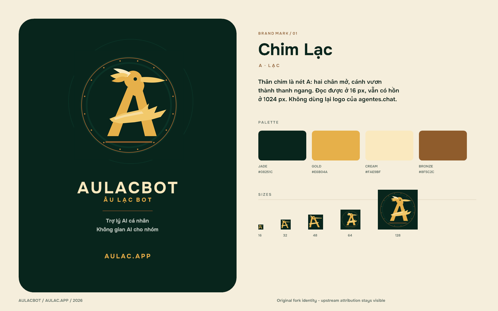

# AULACBOT Brand Kit

> **Superseded on 2026-11-17.** The chosen identity is **Cyber Lạc** in
> [`cyber-lac/`](cyber-lac/README.md). This folder is kept for history; do not use its A-mark for
> new work.

**AULACBOT** / **Âu Lạc Bot** · Personal AI Assistant & Team AI Workspace · [aulac.app](https://aulac.app)

This is the fork's own identity. It is not derived from agentes.chat, and it does not replace the
upstream attribution that `NOTICE` requires in the About screen.



## The mark

The bird is a **Lạc bird**, the water bird on the Đông Sơn bronze drums: long neck, long bill, a
three-feather crest, and a raised wing. The bird is also an **A**:

- its two legs are the A's legs;
- its raised wing is the crossbar;
- the round behind it is the drum's sun and the workspace's channel.

That double reading is the point. At 1024 px it is a bird; at 16 px it is still an A. The mark is
drawn from polygons, strokes and circles, so it has no dependency and no borrowed upstream art.

## Palette

| Name | Hex | Use |
| --- | --- | --- |
| Jade | `#08251C` | Primary background, ink on light |
| Deep Jade | `#0B3226` | Drum bands, secondary surface |
| Gold | `#E6B04A` | The bird, primary accent |
| Light Gold | `#F2C96B` | The wing, labels |
| Cream | `#FAE9BF` | Wordmark on jade, highlights |
| Bronze | `#8F5C2C` | Rim, perch, small rules |

Only Jade and Gold are required for a one-colour application. Cream is the wordmark on Jade;
Jade is the wordmark on Cream.

## Type

Onest (the font already shipped by upstream, OFL) in **Bold 700** for `AULACBOT`, Regular 400 for
the display name and supporting copy. The wordmark is all caps with 50-80 units of tracking per
1000 units of em. Use `Âu Lạc Bot` as a display name, `AULACBOT` as a wordmark, and `aulac.app` as the
domain. Never set the wordmark in the upstream Funnel Display + Doto lockup.

## Assets

| File | Use |
| --- | --- |
| `assets/aulacbot-mark.svg` | Vector app icon, 1024 square, full colour |
| `assets/aulacbot-mark-1024.png` | Master app icon, store and social |
| `assets/aulacbot-mark-transparent.svg` | Mark for a light surface, eye is a cutout |
| `assets/aulacbot-mark-transparent-1024.png` | Transparent master |
| `assets/aulacbot-stamp.svg` | One-colour stamp |
| `assets/aulacbot-stamp-ink-1024.png` | Ink stamp for cream/paper |
| `assets/aulacbot-stamp-cream-1024.png` | Cream stamp for jade/dark |
| `assets/favicon.svg` | Small-size A + bird, 32 grid |
| `assets/favicon.ico` | 16, 32 and 48 px favicon |
| `assets/aulacbot-mark-16/24/32/48/64/128/180/192/256/512.png` | Fixed sizes |
| `assets/aulacbot-logo-dark.png` | Horizontal lockup for dark surfaces |
| `assets/aulacbot-logo-light.png` | Horizontal lockup for light surfaces |
| `assets/aulacbot-wordmark-cream.png` | Wordmark only, dark surfaces |
| `assets/aulacbot-wordmark-jade.png` | Wordmark only, light surfaces |
| `assets/aulacbot-og-1200x630.png` | Open Graph / social card |
| `assets/aulacbot-brand-board.png` | Presentation board, 1600 x 1000 |

## Use

- App icon: 1024 master. The OS applies its own mask; keep the square full-bleed.
- Apple touch icon: `aulacbot-mark-180.png`.
- PWA / Android: `aulacbot-mark-192.png` and `aulacbot-mark-512.png`.
- Favicon: `favicon.ico` (16, 32, 48) or `favicon.svg`.
- Social: `aulacbot-og-1200x630.png`; set `og:image` to `https://aulac.app/...`.
- Clear space: at least the width of the A's left leg on every side.
- Minimum size: 16 px for the app icon and favicon; 96 px for the horizontal lockup.
- On a photograph, use the jade tile, not the transparent bird.

Do not stretch, rotate, outline, add a second bird, put the bird on the upstream blue, or replace
the `AULACBOT` wordmark with `agentes`. Do not use the upstream agent mark as AULACBOT's icon.

## Regenerate

```powershell
bun docs/branding/legacy/generate.mjs
pwsh -NoProfile -File docs/branding/legacy/make-board.ps1
```

`generate.mjs` imports only the rasterizer from upstream's icon generator; every shape, colour and
size is in this folder. If upstream moves `packages/ui/scripts/app-icons/raster.mjs`, update that one
import.

## Status

Retired on 2026-11-17 and never wired into the apps: the owner chose Cyber Lạc instead, and the
whole identity is now in [`../cyber-lac/`](../cyber-lac/README.md). This folder is kept so the earlier
work and its files stay traceable; nothing here ships.
